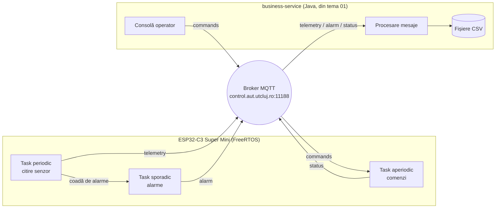

# Tema 02 – Device IoT pe ESP32-C3 cu taskuri FreeRTOS

**Tehnologii:** ESP32-C3 Super Mini, Arduino IDE, FreeRTOS, MQTT, Java 17+ (business-service)
**Termen de predare:** _de stabilit_

## Obiective

După rezolvarea temei, veți putea să:

- implementați taskurile **periodic**, **sporadic** și **aperiodic** din tema 01 pe un microcontroller, ca taskuri **FreeRTOS**;
- folosiți mecanismele FreeRTOS pentru timp și comunicare: **așteptarea absolută** (`xTaskDelayUntil`) și **cozile** (`xQueueSend` / `xQueueReceive`);
- conectați un dispozitiv real la sistemul din tema 01, fără să modificați serviciul care îl folosește.

## Ce se schimbă față de tema 01

În tema 01, device-ul era simulat de o aplicație Java. În această temă îl înlocuiți cu o placă **ESP32-C3 Super Mini**, care face exact același lucru: citește un senzor de temperatură, publică telemetria, trimite alarme și execută comenzi. **Business-service-ul rămâne neschimbat.**



Ca business-service-ul să funcționeze fără modificări, placa trebuie să respecte **exact protocolul din tema 01**: aceleași topic-uri, același format al mesajelor, aceleași comenzi. Pentru business-service, placa este doar încă un device, cu ID-ul `esp32-1`. Puteți rula în paralel și `device-simulator` din tema 01: dashboard-ul va afișa ambele device-uri.

## De la thread-uri Java la taskuri FreeRTOS

Pe ESP32, Arduino rulează peste **FreeRTOS**, un sistem de operare de timp real. Acesta oferă direct mecanismele pe care în Java le-ați simulat: taskuri cu priorități fixe, planificare preemptivă și așteptare absolută pe grila de eliberări. Logica temei rămâne aceeași; se schimbă doar uneltele:

| Tema 01 (Java) | Tema 02 (ESP32, FreeRTOS) |
|----------------|---------------------------|
| `new Thread(task).start()` | `xTaskCreate(functie, "nume", 4096, NULL, prioritate, NULL)` |
| `run()` cu buclă `while (true)` | funcția taskului, cu buclă `for (;;)`; nu are voie să se termine |
| așteptare absolută: `next += periodMs`, apoi așteptare până la `next` (`System.nanoTime()`) | `xTaskDelayUntil(&last, pdMS_TO_TICKS(T))`: așteaptă până la `last + T` și actualizează `last` |
| `BlockingQueue<Double>`, `put()` / `take()` | `QueueHandle_t`, `xQueueSend()` / `xQueueReceive(..., portMAX_DELAY)` |
| callback-ul Paho pune mesajul în coada `commands` | handlerul evenimentelor MQTT (`MQTT_EVENT_DATA`) pune comanda în coada de comenzi |
| `MqttConnection.publish(topic, text)` | `esp_mqtt_client_publish(client, topic, text, 0, 1, 0)` |
| `System.currentTimeMillis()` | `epoch_ms()` din schelet, corect după sincronizarea orei prin SNTP |
| `System.nanoTime()` (timp monoton) | `millis()` sau `xTaskGetTickCount()` |
| `volatile` pentru perioadă și prag | `volatile` (variabile globale, citite și modificate din taskuri diferite) |

Diferența importantă față de Java: aici **prioritățile contează**. ESP32-C3 are un singur nucleu, iar planificatorul FreeRTOS rulează mereu taskul gata de execuție cu prioritatea cea mai mare. Alegeți prioritățile celor trei taskuri între 2 și 19: peste `loopTask` (1), dar sub taskurile sistemului care se ocupă de evenimente și de Wi-Fi (20 și 23).

## Resurse puse la dispoziție

### `exemple/`

Un singur [`README.md`](exemple/README.md), cu:

- legătura către repository-ul cu laboratoare ESP32 [`rt-labs-esp32c3`](https://github.com/automatica-cluj/rt-labs-esp32c3), din care vă interesează în primul rând **exemplele din laboratorul 0** (`lab0-arduino-basics`);
- pașii de configurare a Arduino IDE și a plăcii, plus problemele frecvente la prima conectare.

Repository-ul cu laboratoare este o **sursă de exemple de cod**. Nu trebuie să parcurgeți laboratoarele pas cu pas. Citiți și rulați exemplele din laboratorul 0, mai ales `mqtt_hello`, care conectează placa la Wi-Fi și la brokerul MQTT.

### `start/esp32_device/`

Scheletul schiței Arduino. Compilează, dar nu face încă nimic.

| Fișier | Ce conține |
|--------|------------|
| `config.h` | rețeaua Wi-Fi, brokerul, `STUDENT`, `DEVICE_ID`, valorile inițiale (perioada, pragul, intervalul minim între sosiri) și `make_topic()`, care construiește numele topic-urilor |
| `esp32_device.ino` | `read_temperature()` (senzorul intern), `epoch_ms()` (timestamp-ul), funcțiile goale ale celor trei taskuri și `setup()`, cu `TODO 0` … `TODO 3` |

Deschideți `esp32_device.ino` în Arduino IDE (folderul și fișierul `.ino` au același nume, cum cere Arduino IDE). Setările plăcii sunt în [`exemple/README.md`](exemple/README.md#2-configurarea-arduino-ide).

### `start/business-service/`

Proiectul din tema 01, copiat neschimbat, cu `TODO 4` … `TODO 6`. **Copiați aici rezolvarea voastră din tema 01** (`MessageProcessor`, `Dashboard`, `CommandConsole`) și setați `STUDENT` în `Config.java`.

```bash
cd start/business-service
mvn -q compile exec:java
```

## Senzorul de temperatură

Placa nu are un senzor extern. Se folosește **senzorul intern al ESP32-C3**, citit cu `temperatureRead()` (în schelet: `read_temperature()`). Acesta măsoară temperatura cipului, nu a camerei:

- valoarea este mai mare decât temperatura camerei: imediat după conectarea la Wi-Fi poate fi în jur de 50 °C, apoi scade în câteva minute și se stabilizează, de obicei între 35 și 40 °C;
- rezoluția este de aproximativ 1 °C, deci valorile publicate sar din grad în grad (`36.80`, `35.80`, ...);
- odată stabilizată, variază puțin, deci alarmele nu apar singure, ca în tema 01.

Cu pragul inițial de 45 °C, alarmele apar doar în primele secunde după pornire. Ca să provocați alarme mai târziu, urmăriți telemetria și trimiteți un prag cu un grad sub valoarea citită, de exemplu `esp32-1 SET_THRESHOLD 35`. Temperatura publicată trece atunci de prag la fiecare job, iar taskul sporadic trebuie să respingă evenimentele care sosesc mai des decât `MIN_INTERARRIVAL_MS`.

## Brokerul MQTT, topic-urile și mesajele

Totul este ca în [tema 01](../tema-01-iot-mqtt/README.md#brokerul-mqtt): brokerul `control.aut.utcluj.ro`, portul `11188`, fără autentificare, și topic-urile sub `ssatr/<student>/`. Pe ESP32, adresa brokerului se scrie ca URI: `mqtt://control.aut.utcluj.ro:11188`.

| Topic | Direcție | Tip task | Conținut |
|-------|----------|----------|----------|
| `ssatr/<student>/devices/esp32-1/telemetry` | device → service | periodic | `esp32-1;timestamp;temperatura` |
| `ssatr/<student>/devices/esp32-1/alarm` | device → service | sporadic | `esp32-1;timestamp;temperatura;prag` |
| `ssatr/<student>/devices/esp32-1/commands` | service → device | aperiodic | `SET_INTERVAL 1000` |
| `ssatr/<student>/devices/esp32-1/status` | device → service | aperiodic | `esp32-1;timestamp;OK SET_INTERVAL 1000` |

Comenzile pe care trebuie să le accepte device-ul:

| Comandă | Efect |
|---------|-------|
| `SET_INTERVAL <ms>` | schimbă perioada $T$ a taskului periodic |
| `SET_THRESHOLD <valoare>` | schimbă pragul de alarmă |
| `RESET` | readuce perioada și pragul la valorile inițiale (`PERIOD_MS_INITIAL`, `THRESHOLD_INITIAL`) |
| `STATUS` | răspunde cu perioada și pragul curente |

Senzorul intern nu poate fi „resetat”, de aceea comanda `RESET` are alt efect decât în tema 01.

### Detalii la care trebuie să fiți atenți pe ESP32

- **Timestamp-ul** este, ca în Java, numărul de milisecunde de la 1 ianuarie 1970. Placa nu are ceas de timp real: la pornire nu știe ora. O aflați prin **SNTP**, după conectarea la Wi-Fi: `configTime(0, 0, NTP_SERVER)`, apoi așteptați sincronizarea cu `getLocalTime(&tm, 10000)`. Abia după aceea `epoch_ms()` dă valori corecte. Valoarea are 64 de biți și se tipărește cu `%lld`: `(long long)epoch_ms()`.
- **Numerele zecimale** se scriu cu punct: `snprintf(..., "%.2f", t)` pune mereu punct, deci business-service-ul le poate citi cu `Double.parseDouble`.
- **Textul unei comenzi primite** (`ev->data` în `MQTT_EVENT_DATA`) nu se termină cu `'\0'`. Copiați exact `ev->data_len` octeți într-un buffer, adăugați `'\0'`, apoi puneți bufferul în coadă. `xQueueSend` copiază elementul, deci elementul cozii trebuie să fie bufferul însuși, de exemplu un `struct` cu un câmp `char text[64]`, nu un pointer.
- **Handlerul evenimentelor MQTT** rulează pe taskul clientului MQTT, nu pe taskurile voastre. În el doar puneți comanda în coadă, nu o executați: execuția este jobul taskului aperiodic.
- **Abonarea** la topic-ul de comenzi se face la fiecare `MQTT_EVENT_CONNECTED`, ca în `mqtt_hello`: după o reconectare, brokerul a uitat abonările.
- **Client id-ul MQTT** trebuie să fie unic pe broker, de exemplu `popescu-ion-esp32-1`. Doi clienți cu același id se deconectează unul pe altul la nesfârșit.
- **Stiva taskurilor**: pe ESP32, dimensiunea din `xTaskCreate` este în octeți. `snprintf` cu numere zecimale are nevoie de stivă, deci folosiți cel puțin 4096. O stivă prea mică repornește placa, cu un mesaj `Stack canary watchpoint triggered` în Serial Monitor.
- **Serial Monitor** este singura voastră fereastră spre placă: afișați pe `Serial` ce face fiecare task (job pornit, alarmă respinsă, comandă executată).

## Cerințe

### 1. Device-ul ESP32 (`start/esp32_device/`)

- **TODO 0 – structura aplicației** (`setup()`): conectarea la Wi-Fi, sincronizarea orei prin SNTP, crearea celor două cozi, pornirea clientului MQTT (cu abonarea la topic-ul de comenzi și punerea comenzilor primite în coadă) și pornirea celor trei taskuri, cu prioritățile alese de voi. În tema 01, partea aceasta era dată gata (`DeviceSimulator`, `MqttConnection`). Porniți de la `mqtt_hello` din laboratorul 0.
- **TODO 1 – task periodic** (`periodic_task`): la fiecare job citește senzorul și publică telemetria. Eliberările respectă grila, cu perioada $T$ = `g_period_ms`. Folosiți **așteptare absolută** (`xTaskDelayUntil`), nu relativă (`vTaskDelay`), ca să nu apară derivă. Când temperatura depășește pragul, jobul pune un eveniment în coada de alarme.
- **TODO 2 – task sporadic** (`sporadic_task`): publică alarmele și impune intervalul minim între sosiri `MIN_INTERARRIVAL_MS`: evenimentele care sosesc mai des sunt respinse.
- **TODO 3 – task aperiodic** (`aperiodic_task`): execută comenzile din tabelul de mai sus și publică o confirmare pe topic-ul `status`. O comandă greșită produce un mesaj `ERROR ...` și nu oprește taskul.

### 2. Serviciul business (`start/business-service/`)

- Rezolvarea voastră din tema 01 (`TODO 4` … `TODO 6`), adusă în acest proiect. Serviciul trebuie să afișeze în dashboard device-ul `esp32-1`, să-i salveze mesajele în fișierele CSV și să-i trimită comenzi.

### 3. Funcționarea completă

Sistemul trebuie să funcționeze cap-coadă: placa publică telemetria cu perioada cerută, alarmele apar când temperatura trece de prag (cel mult una la `MIN_INTERARRIVAL_MS`), iar toate cele patru comenzi trimise din consola business-service-ului sunt executate și confirmate.

## Predare

Soluția se află în fork-ul vostru, în folderul `tema-02-esp32-mqtt/`:

```
tema-02-esp32-mqtt/
└── start/
    ├── esp32_device/         # schița completată
    └── business-service/     # proiectul completat (rezolvarea din tema 01)
```

**Nu urcați în fork parola rețelei voastre Wi-Fi.** Înainte de commit, puneți înapoi în `config.h` valorile pentru `iot-demo`.

După push, adăugați commit ID-ul soluției (`git rev-parse HEAD`) ca **comentariu** la assignment-ul temei din **Microsoft Teams** și apăsați **Turn in**. Detalii în [README-ul principal](../README.md#predare).

## Bibliografie

- Cursul: [2.3 Eliberare periodică](https://control.aut.utcluj.ro:8030/part-02-time/03-periodic-release/), [3.2 Modelul de task](https://control.aut.utcluj.ro:8030/part-03-scheduling/02-task-model/)
- [rt-labs-esp32c3](https://github.com/automatica-cluj/rt-labs-esp32c3): laboratorul 0, `docs/freertos_concepts.md`
- [FreeRTOS: `xTaskDelayUntil`](https://www.freertos.org/Documentation/02-Kernel/04-API-references/02-Task-control/03-xTaskDelayUntil), [cozi](https://www.freertos.org/Documentation/02-Kernel/02-Kernel-features/02-Queues-mutexes-and-semaphores/01-Queues)
- [ESP-IDF: clientul MQTT](https://docs.espressif.com/projects/esp-idf/en/stable/esp32c3/api-reference/protocols/mqtt.html), [ora sistemului și SNTP](https://docs.espressif.com/projects/esp-idf/en/stable/esp32c3/api-reference/system/system_time.html)
- [Documentația Arduino-ESP32](https://docs.espressif.com/projects/arduino-esp32/en/latest/)
